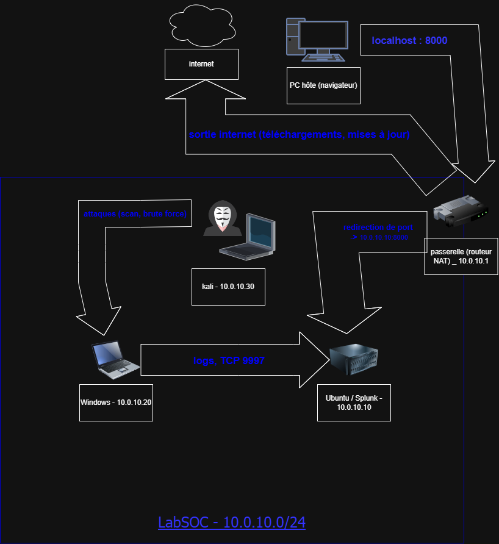

# SOC Home Lab — Détection d'attaques avec Splunk

Lab virtualisé pour simuler des attaques sur une machine Windows et les détecter dans un SIEM Splunk, comme le ferait un analyste SOC.

## Objectif

Construire une chaîne de détection complète : lancer une attaque, collecter les journaux de la machine ciblée, les centraliser dans un SIEM, puis écrire des règles qui lèvent une alerte. Le but est de comprendre les traces que laisse un attaquant et la façon dont un SOC les exploite pour réagir.

## Architecture

Réseau isolé **10.0.10.0/24** (réseau NAT VirtualBox `LabSOC`).

| Machine | Rôle | OS | IP |
|---|---|---|---|
| splunk-srv | SIEM (Splunk Enterprise) | Ubuntu Server 24.04 LTS | 10.0.10.10 |
| WIN-VICTIME | Cible, avec Sysmon et Universal Forwarder | Windows 11 Entreprise | 10.0.10.20 |
| Kali | Attaquant | Kali Linux | 10.0.10.30 |
| Passerelle | Routage et sortie Internet | NAT VirtualBox | 10.0.10.1 |

### Flux

| Source → destination | Port | Rôle |
|---|---|---|
| Kali → Windows | variable | Attaques (scan, brute force) |
| Windows → Splunk | TCP 9997 | Envoi des journaux par le Universal Forwarder |
| PC hôte → Splunk | TCP 8000 (redirigé) | Interface web via `127.0.0.1:8000` |
| PC hôte → Splunk | TCP 2222 → 22 (redirigé) | Administration en SSH |
| VM → Internet | — | Mises à jour et téléchargements via la passerelle |

Les redirections de port n'écoutent que sur `127.0.0.1` : le lab n'est pas exposé au réseau local.

## Choix techniques

- **Splunk tourne sous un compte dédié `splunk`**, et non en root, avec un démarrage automatique géré par systemd.
- **Comptes séparés** : le compte système Ubuntu et le compte administrateur Splunk sont distincts.
- **Adresses IP fixes** sur toutes les machines, pour que les journaux et les règles de détection restent cohérents.
- **Administration à distance en SSH** depuis l'hôte, sans passer par la console de la VM.

## Avancement

- [x] Architecture et schéma réseau
- [x] Réseau NAT 10.0.10.0/24 et redirections de ports (8000, 2222)
- [x] VM Ubuntu Server (IP fixe, SSH)
- [x] Splunk Enterprise (compte dédié, démarrage automatique, réception sur le port 9997)
- [ ] VM Windows et Sysmon
- [ ] Universal Forwarder (Windows → Splunk:9997)
- [ ] VM Kali
- [ ] Vérification de la réception des journaux Windows et Sysmon
- [ ] Détection 1 : scan Nmap (alerte SPL)
- [ ] Détection 2 : brute force (alerte SPL)
- [ ] Guide d'installation reproductible

## Détections prévues

| Détection | Technique MITRE ATT&CK | Statut |
|---|---|---|
| Scan de ports Nmap | T1046 — Network Service Discovery | À venir |
| Brute force sur un compte | T1110 — Brute Force | À venir |

Chaque détection sera documentée avec sa requête SPL, une capture de l'alerte et les traces observées.

## Captures

**Splunk accessible depuis l'hôte (redirection du port 8000)**

**Réception des journaux activée (port 9997)**

## Compétences mobilisées

SIEM Splunk · SPL · virtualisation (VirtualBox) · administration Linux · réseau (NAT, redirection de ports, adressage IP) · journalisation Windows (Sysmon) · détection d'intrusion

## Auteur

Mehdi Bouahouze — BUT Réseaux et Télécommunications, parcours Cybersécurité (IUT de Roanne)
