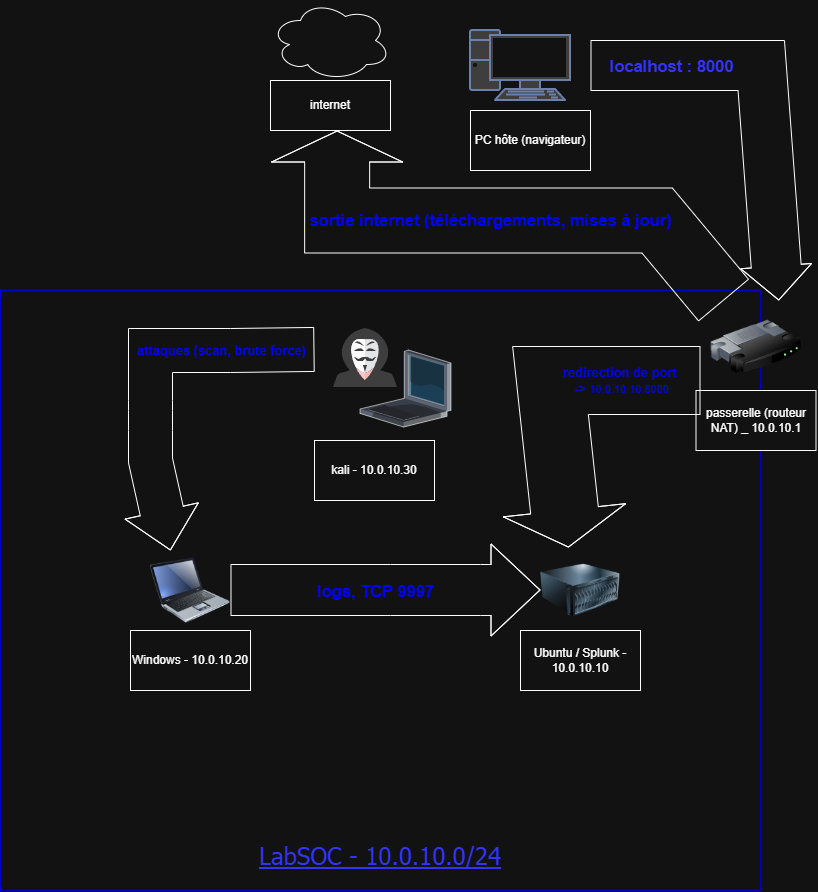

# soc-home-lab_personelle_mehdy
Home lab SOC : détection d'attaque avec Splunk (Kali, Universal Forwarder)

## L'onjectif
Monter un lab pour simuler des attaques et les détecter dans un SIEM (splunk), comme un analyste SOC L1 et ainsi mieux comprendre les mécanisme de l'attaquant jusqu'à l'endigation de c'elle-ci

## Architecture

| Machine | Rôle | OS | IP |
| kali | attaquant | Kali Linux | 10.0.10.30 |
| Windows | victimme avec l'universal Forwarder | Windows | 10.0.10.20 |
| Ubuntu Server | SIEM Splunk | ubuntu serv | 10.0.10.10 |
| routeur NAT | passerelle | *** | 10.0.10.10 |

**Flux :**
- Kali -> Windows : attaques (scan, brute force)
- Windows -> Splunk (TCP 9997) : envoie des logs
- PC hôte 'Localhost : 80000' -> redirection de port -> splunk (10.0.10.10:80000)
- passerelle -> Internet : les téléchargements et les mise à jour

## Avancement
- [x] Conception de l'architecture et schéma réseau
- [ ] Mise en place du réseau NAT 10.0.10.0/24 et des 3 VM
- [ ] Installation de Splunk Enterprise (Ubuntu)
- [ ] Accès à Splunk depuis l'hôte (redirection de port 8000)
- [ ] Installation du Universal Forwarder (Windows) → Splunk:9997
- [ ] Vérification de la réception des logs dans Splunk
- [ ] Attaque 1 : scan nmap depuis Kali + détection
- [ ] Attaque 2 : brute force + détection
- [ ] Write-up d'analyse

## Compétences
SIEM Splunk, SPL, virtualisation, réseau, détection d'intrusion
